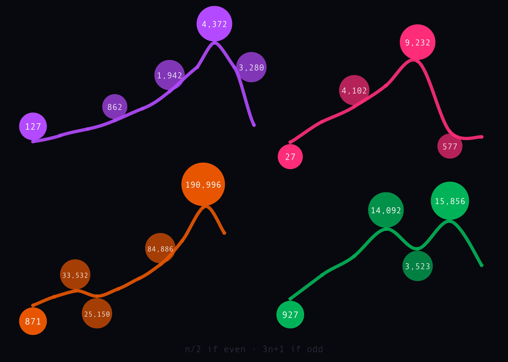
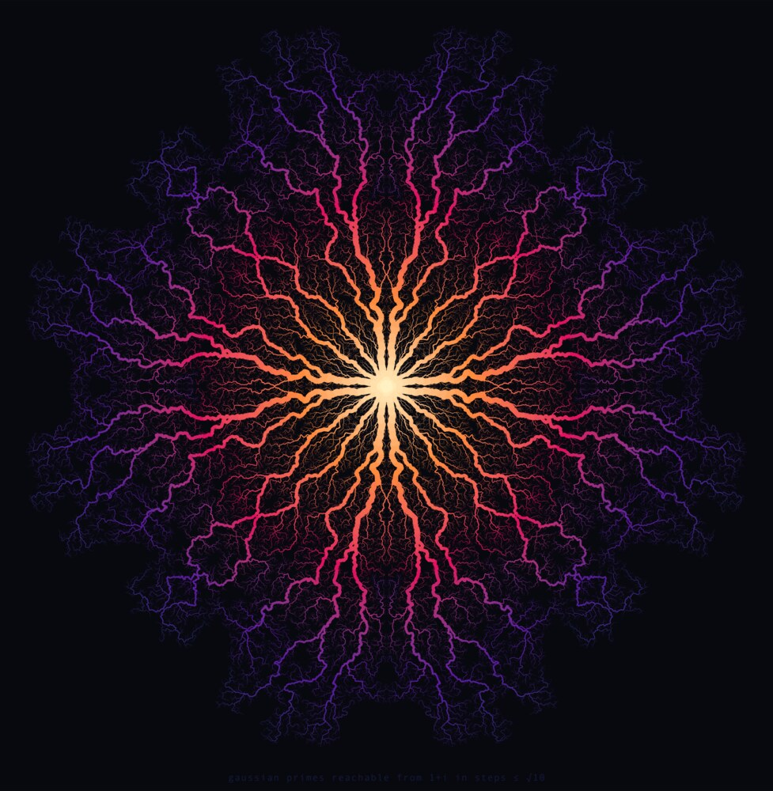
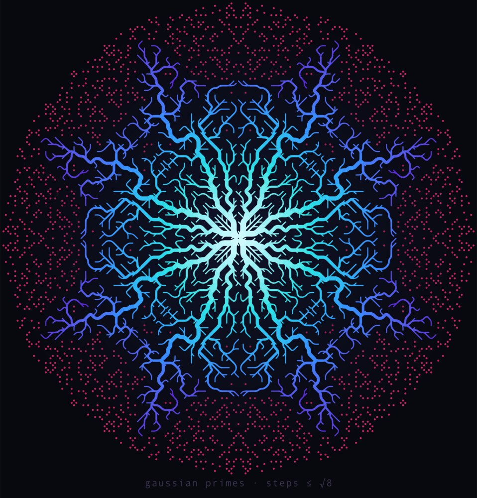

# designs

Visual designs for t-shirts and posters. Each design lives in its own directory
with a README describing the idea, the editable vector source, and a print-ready
raster.

## Gallery

| Design | Medium | Description |
|--------|--------|-------------|
| [collatz](collatz/) | T-shirt (dark) | Four Collatz sequences, each with a different shape: staircase, mountain, V-dip, double peak. |
| [gaussian-primes](gaussian-primes/) | 2 t-shirts, 3 posters | How far you can walk on Gaussian primes with bounded steps, drawn as branching river networks. |

## Adding a design

Create a directory named for the design containing:

- `README.md`: the concept, how it was made, colors, and print notes.
- The vector source (SVG) that every raster is rendered from, plus the generator
  script when the SVG is computed.
- A high-resolution PNG for printing (about 4000px wide for a 12" print area).

Then add a row to the gallery table above.
