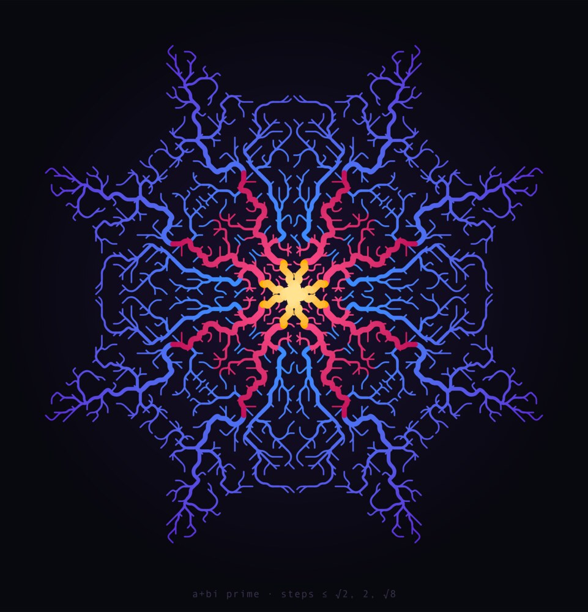
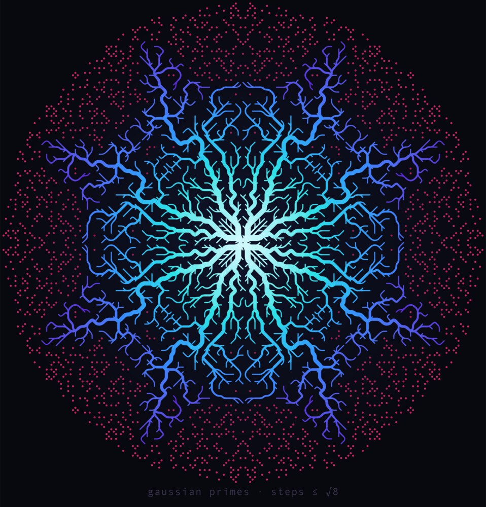
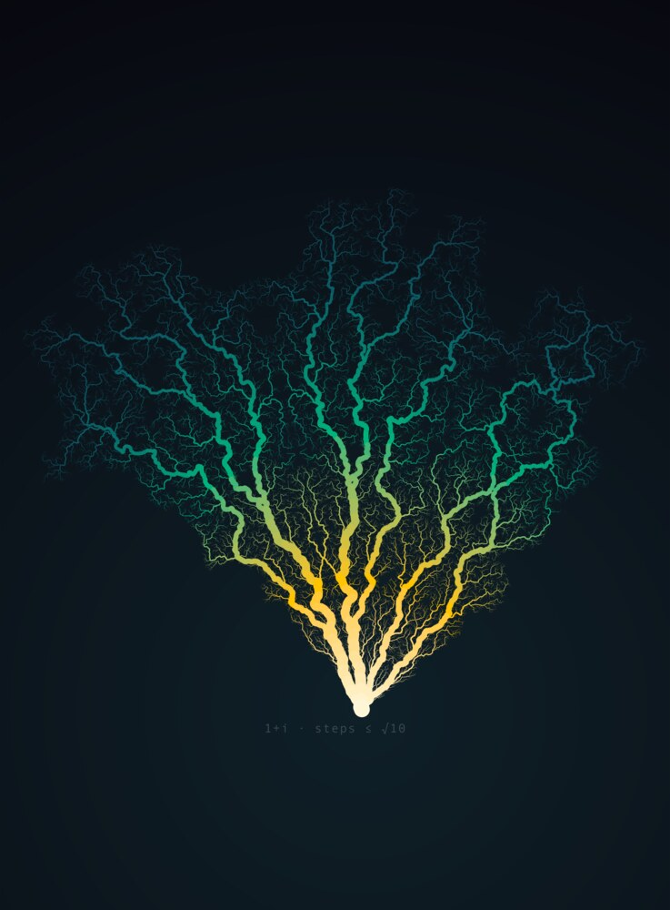
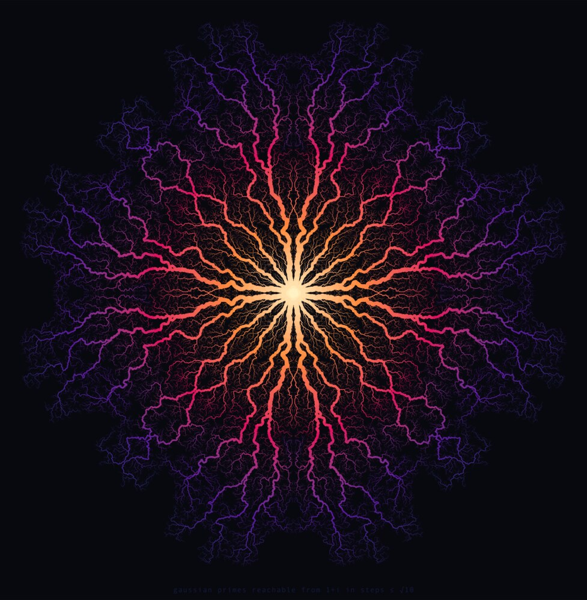
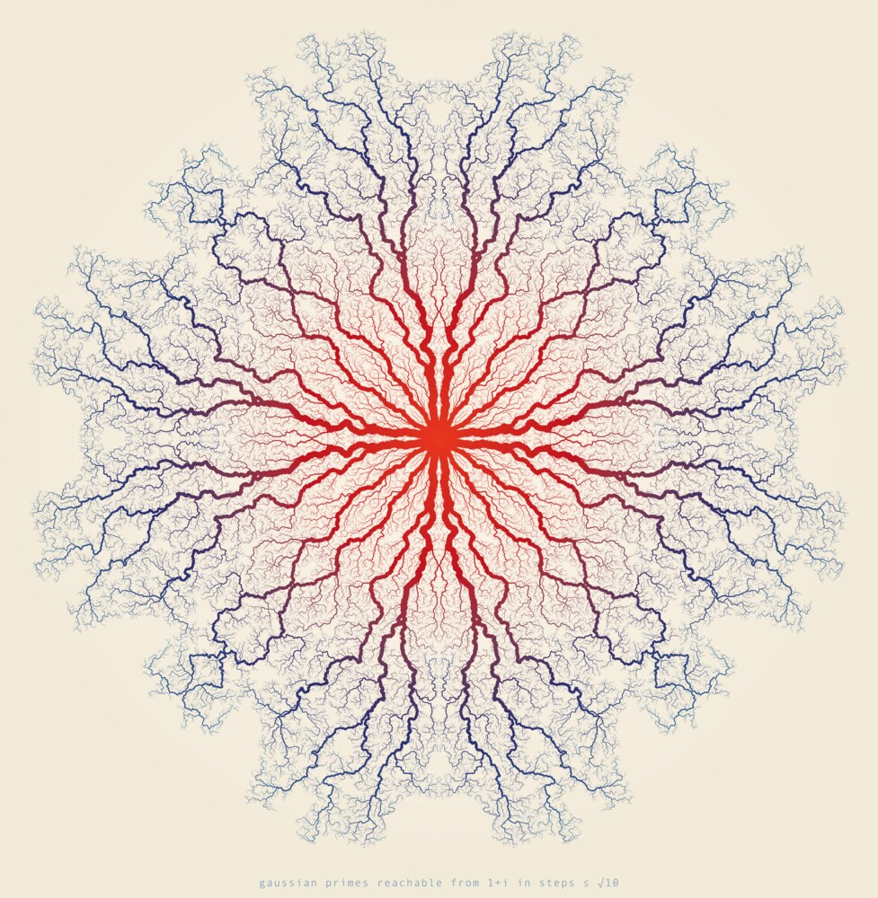

# Gaussian Prime Reachability

Five designs drawn from one question: if you may only stand on Gaussian primes and
every step is at most some fixed length, how far can you walk from the origin? The
places you can reach form a branching network that looks grown rather than computed,
with river deltas, lightning, and coral, held in the eight-fold symmetry of the
Gaussian integers.

| | | |
|---|---|---|
|  |  |  |
| **rings** (shirt) | **moat** (shirt) | **tree** (portrait poster) |
|  |  | |
| **delta** (poster) | **delta-paper** (poster) | |

## The mathematics

A Gaussian integer a+bi is a Gaussian prime when a²+b² is an ordinary prime, or when
it is ±p or ±pi for an ordinary prime p ≡ 3 (mod 4). They scatter across the plane
with the symmetry of a square: rotate by 90° or reflect across an axis or diagonal and
the pattern is unchanged.

The Gaussian moat problem asks whether you can walk to infinity on Gaussian primes
using steps of bounded length. Nobody knows, though the answer is believed to be no:
for every step bound tried, there is a "moat" of composites too wide to cross.
Starting at 1+i, the reachable set is finite for every bound used here:

| max step | primes reached | farthest |
|---|---|---|
| √2 | 100 | 11.7 |
| 2 | 720 | 45.3 |
| √8 | 2,996 | 93.5 |
| √10 | 249,508 | 1,024.4 |

Steps of length √5 add nothing beyond 2, and √13 adds nothing beyond √10. The jump
from √8 to √10 is the dramatic one: one more allowed step length grows the island
eightyfold.

## How the pictures are made

Each reachable set is turned into a tree. Starting from 1+i and its three rotations, a
shortest-path search (Dijkstra, Euclidean step lengths) gives every reachable prime a
parent one step closer to the origin. Parents are chosen in one octant and mirrored to
the others, so the tree keeps the full eight-fold symmetry. A prime that lies exactly
on a mirror line may have two mirror-image parents; the tree has to pick one.

A branch's thickness grows with the number of primes beyond it, as in a river
network: width = a + b·(subtree size)^p with p between 0.4 and 0.55. Color follows
distance along the tree from the origin, interpolated in OKLab so that gradients stay
even in brightness. The smaller designs smooth each branch into quadratic curves
through midpoints, which makes forks split like plant stems. The √10 designs keep
straight segments, because the lattice jitter at that scale reads as lightning.

## The designs

### rings: t-shirt, dark

The √2, 2, and √8 components nested as three growth rings. Each prime takes its
parent from the smallest step bound that reaches it, so gold branches use steps of at
most √2, pink branches need steps of 2, and blue branches need √8. The picture shows
the island growing each time the allowed step lengthens.

Palette: gold #fff0a8→#ffb000, pink #ff4f8b→#c2105a, blue #3d8bff→#5a2bd6 on #08080f.

### moat: t-shirt, dark

The √8 island glowing cyan to violet, surrounded by every Gaussian prime it cannot
reach, shown as hot-pink dots. The dark gap between the island and the dots is the
moat.

Palette: #d9fbff→#2de2e6→#3a86ff→#5a2bd6 tree, #ff2d78 stranded primes, #08080f ground.

### delta: square poster, dark

All 249,508 primes of the √10 component. Trunks run white-hot at the center through
orange and magenta to violet at the edges, and the finest twigs are faded so the
trunks read first.

Palette: #fff1c1→#ff8a3d→#e0115f→#5b1a9e→#1b2a6b on #08080f.

### delta-paper: square poster, light

The same network inked on cream stock: vermilion trunks shading to navy and steel
blue. It reads like an anatomical plate of a vascular system.

Palette: #e8361e→#c1121f→#2b2d6e→#2f6f9f on #f2ead9 with a lighter center.

### tree: 3:4 portrait poster, dark

The quarter of the √10 network that descends from 1+i, rotated to grow upward from a
single root. It spreads across about 30° to 135°, not symmetrically around 1+i's own
45°, so it is aimed by the middle of its actual spread.

Palette: #fff6d8→#ffc300→#00b37a→#0a5c66→#0d2b3e on #08080f.

## Print notes

| design | PNG pixels | intended print | thinnest stroke at that size |
|---|---|---|---|
| rings | 4000 × 4161 | 12 in wide shirt | 0.031 in |
| moat | 4000 × 4177 | 12 in wide shirt | 0.028 in; dots 0.05 in |
| delta, delta-paper | 6000 × 6143 | 20 in square at 300 dpi | 0.004 in |
| tree | 4000 × 5425 | 18 × 24 in | 0.006 in |

Both shirt designs clear the ~0.012 in minimum for screen printing and DTG. The poster
twigs are hairlines meant for giclée or offset printing. They would fill in or drop out
in a screen print. For a larger poster, render the SVG at a higher width rather than
upscaling the PNG.

## Files

- `rings`, `moat`, `delta`, `delta-paper`, `tree`: `.svg` vector source and `.png`
  print raster for each design.
- `previews/`: 1000px JPEGs for this page.
- `generate.py`: the five designs. Run `uv run generate.py [name ...]`.
- `gprimes.py`: Gaussian primes, reachable components, symmetric shortest-path trees.
- `svg.py`: OKLab color ramps, stroke bucketing, page assembly, Inkscape rendering.
- `test_gprimes.py`: known component sizes and tree invariants.

Rendering needs Inkscape and ImageMagick on the path. The first run computes the √10
component, about 30 seconds, and caches the trees in `.cache/`. Checks:

    uv run ruff check . && uv run pyright . && uv run pytest -x
